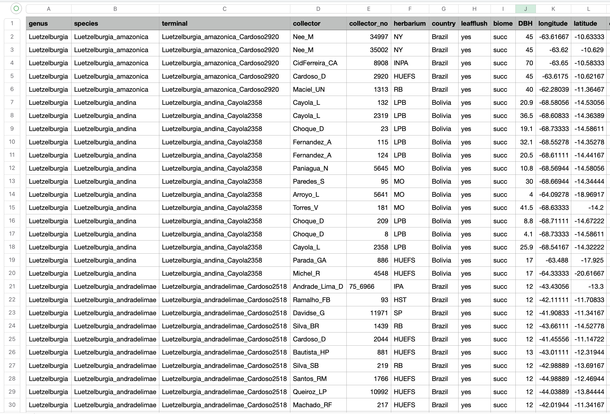

# 1. Creating input data for independent contrast regression analysis

  
The main goal of the **InNOutBT** package is to readily create input
data and process output data for Meade & Pagel’s (2022)
[BayesTraits](https://www.evolution.reading.ac.uk/BayesTraitsV5.0.3/BayesTraitsV5.0.3.html)
program.  

We describe how **InNOutBT**’s function `phyreg.inputs` creates two
input text files representing samples of trait/climate data. One text
file reports mean values for each sample of traits and a second text
file reports linked samples of trait values in a format used in the
phylogenetic independent contrast regression analyses. This function
includes an argument to calculate the net node count for each
species/accession given a phylogenetic tree, which is used to explore
the effects of speciation rates on the response variable (e.g.,
[O’Donovan et al. 2018](https://doi.org/10.1038/s41559-017-0454-6)).  
  

## Setup

**InNOutBT** is not on CRAN yet, but you can install the latest
development version from [GitHub](https://github.com/):

``` r

#install.packages("devtools")
devtools::install_github("DBOSlab/InNOutBT")
```

``` r

library(InNOutBT)
```

  

## Example of a spreadsheet with georeferenced data and associated traits

Outputting longitude and latitude data (columns arranged in that order)
with the terminal label column provides the required formats of the mean
and linked data that can be analyzed using the Geographical Model in
BayesTraits. Before using `phyreg.inputs`, make sure your spreadsheet
with georeferenced data and associated traits also includes a
**terminal** column where each accession/sample is linked to the
corresponding tip label in the input phylogenetic tree.  
  
  
  

## Create a sample of trait data using a subset of explanatory variables

The example below generates the linked and mean data files where “DBH”
is defined as the response variable because it is listed first and
“bio12” and “bio15” are the explanatory variables because they are
listed second and third. Thus, the first name reported in the argument
`traitcols` will define the response variable.  

``` r

library(InNOutBT)
library(treeio)

traitdata <- read.csv("Data/vataireoids_1610_25May2022_BayesTraits.csv")
phylo <- read.beast("Data/vatcomb30_24May22_Yule.con.tree")

phyreg.inputs(tree = phylo,
              data = traitdata,
              tipscol = "terminal",
              traitcols = c("DBH", "bio12", "bio15"),
              dir_create = "results_BayesTraits_phyreg_input",
              fileDistData = "BayesTraits_linked_data_bio12_bio15.txt",
              fileMeanData = "BayesTraits_mean_data_bio12_bio15.txt")
```

  

## Log-transform any variable before creating the input mean and linked data

You may want to log10-transform a variable before running the
phylogenetic regression analysis. In the argument `logtransf`, just
report the variables/traits to be log-transformed. The log-transformed
trait will always result in a new column with a new name where the
additional prefix “log10” is added, as in the following:
“log10NAMEOFTHETRAIT”. The name(s) of the log-transformed trait(s) to be
used in the analyses should then be listed in the argument `addtraits`.
Note that in the example below, the variable “DBH” was chosen to be
log-transformed and also to serve as the response variable. In this
case, we need to reorder the variables in the argument `ordtraits` so as
to make sure your newly generated “log10DBH” variable will be reported
first and thus serve as the response variable. You may also want to save
a copy of the original spreadsheet that includes the new column of
log-transformed DBH by reporting a name for the data file copy in the
argument `fileOrigData`.  

``` r

phyreg.inputs(tree = phylo,
              data = traitdata,
              tipscol = "terminal",
              logtransf = "DBH",
              traitcols = c("bio12", "bio15"),
              addtraits = "log10DBH",
              ordtraits = c("log10DBH", "bio12", "bio15"),
              dir_create = "results_BayesTraits_phyreg_input",
              fileDistData = "BayesTraits_linked_data_bio12_bio15.txt",
              fileMeanData = "BayesTraits_mean_data_bio12_bio15.txt",
              fileOrigData = "vataireoids_1610_25May2022_BayesTraits_DBH_logtransf.csv")
```

  

## Create a sample of trait data using a different subset of explanatory variables

By setting the argument `NodeCount = TRUE`, the function will calculate
the net node count for each species/accession given the phylogenetic
tree of reference. Net nodes, or node count, have been used to explore
the effects of speciation rates (e.g., [O’Donovan et
al. 2018](https://doi.org/10.1038/s41559-017-0454-6)) on the response
variable. In the example below, we chose to log10-transform both the
response variable “DBH” and the newly created column of net nodes, all
of which were then listed in the arguments `addtraits` and
`ordtraits`.  

``` r

phyreg.inputs(tree = phylo,
              data = traitdata,
              tipscol = "terminal",
              NodeCount = TRUE,
              logtransf = c("DBH", "NodeCount"),
              traitcols = c("bio12", "bio15"),
              addtraits = c("log10NodeCount", "log10DBH"),
              ordtraits = c("log10DBH", "bio12", "bio15", "log10NodeCount"),
              dir_create = "results_BayesTraits_phyreg_input",
              fileDistData = "BayesTraits_linked_data_bio12_bio15_nnodes.txt",
              fileMeanData = "BayesTraits_mean_data_bio12_bio15_nnodes.txt",
              fileOrigData = "vataireoids_1610_25May2022_BayesTraits_netnodes_logtransf.csv")
```

  

## Create a sample of trait data using quadratic net nodes as the explanatory variable

You may want to square the log10-transformed values of a variable before
running the phylogenetic regressions. You just need to provide in the
argument `sqrtransf` the variables/traits to be log10-transformed and
squared. The transformed trait will always result in a new column with a
new name where the additional prefix “sqr” is added as follows:
“sqrNAMEOFTHETRAIT”. The name(s) of the transformed trait(s) to be used
in the analyses should then be listed in the argument `addtraits`. Note
that in the example below, the newly created variable “NodeCount” was
chosen to be both log10-transformed and log10-transformed squared.  

``` r

phyreg.inputs(tree = phylo,
              data = traitdata,
              tipscol = "terminal",
              NodeCount = TRUE,
              logtransf = c("DBH", "NodeCount"),
              sqrtransf = c("NodeCount"),
              addtraits = c("sqrNodeCount", "log10DBH"),
              ordtraits = c("log10DBH", "log10NodeCount", "sqrNodeCount"),
              dir_create = "results_BayesTraits_phyreg_input",
              fileDistData = "BayesTraits_linked_data_nnodes_nnodes2.txt",
              fileMeanData = "BayesTraits_mean_data_nnodes_nnodes2.txt",
              fileOrigData = "vataireoids_1610_25May2022_BayesTraits_netnodes_logtransf_sqrtransf.csv")
```

  

## Create a sample of trait data for the GEO model

The example below uses columns of “longitude” and “latitude” in the
original spreadsheet to generate input mean and linked data for use in
the Geographical Model of BayesTraits.  

``` r

phyreg.inputs(tree = phylo,
              data = traitdata,
              tipscol = "terminal",
              NodeCount = FALSE,
              traitcols = c("longitude", "latitude"),
              dir_create = "results_BayesTraits_phyreg_input",
              fileDistData = "BayesTraits_linked_data_GEO.txt",
              fileMeanData = "BayesTraits_mean_data_GEO.txt")
```

  
Once the above text files of mean and linked samples of trait data have
been created, analyzing them can be facilitated by creating a [shell
script](https://dboslab.github.io/InNOutBT/articles/phyreg_shell.html)
with `phyreg.shell` for multiple phylogenetic regression analyses. These
BayesTraits runs are then followed by processing the Log and Stones
files, which is detailed in the article on using `phyreg.outputs` to
[process the resulting output
files](https://dboslab.github.io/InNOutBT/articles/phyreg_outputs.html).
