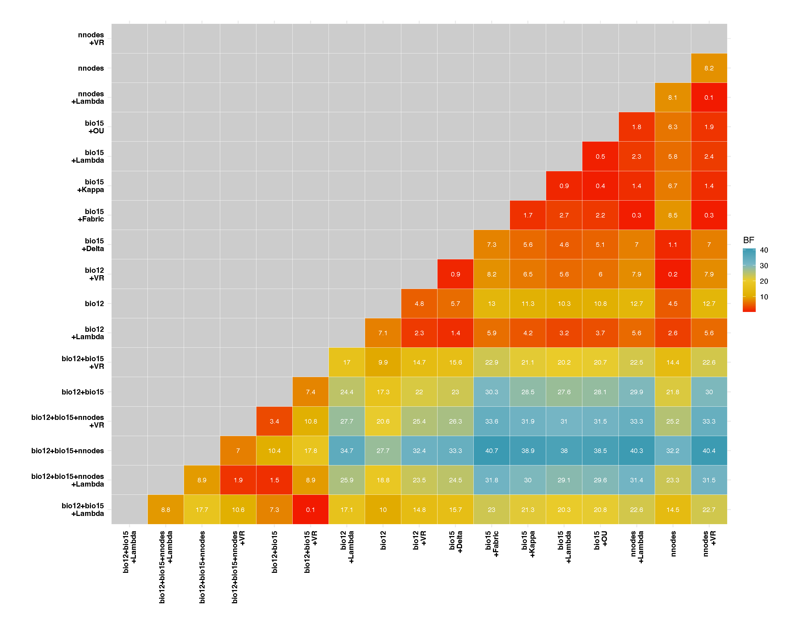
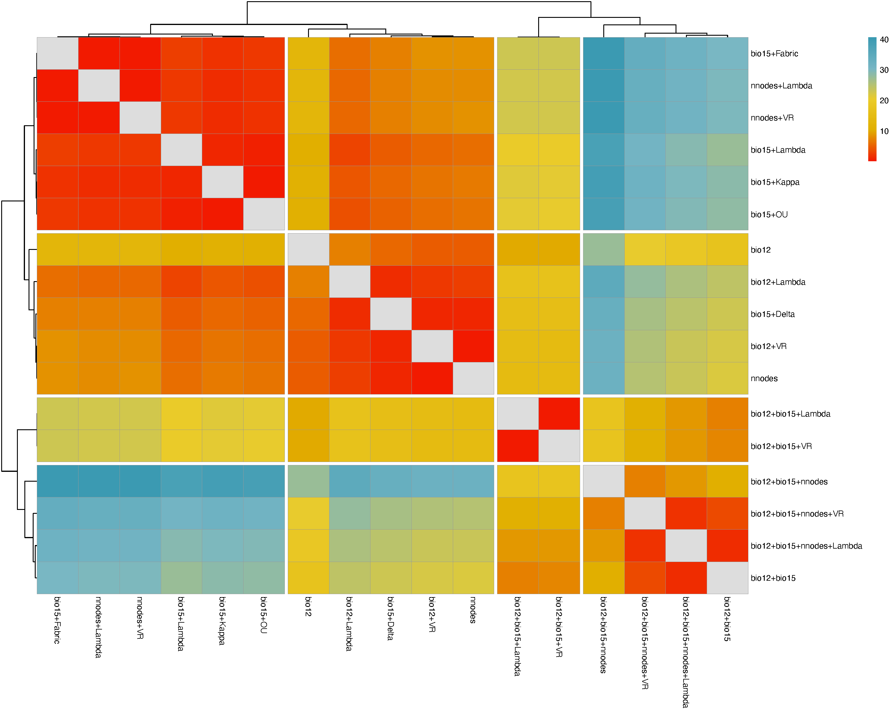
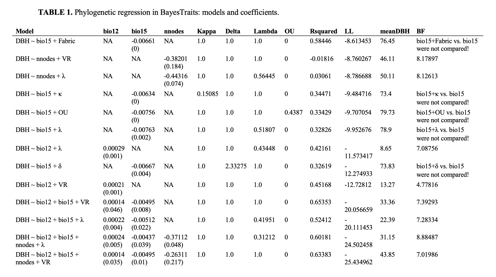

# 3. Processing output data from independent contrast regression analysis

  
The main goal of the **InNOutBT** package is to readily create input
data and process output data for Meade & Pagel’s (2022)
[BayesTraits](https://www.evolution.reading.ac.uk/BayesTraitsV5.0.3/BayesTraitsV5.0.3.html)
program.  

Here we show how to use the package’s function `phyreg.outputs` for
processing all Log and Stones output text files from BayesTraits
phylogenetic independent contrast regression analyses.  
  

## Setup

**InNOutBT** is not on CRAN yet, but you can install the latest
development version from [GitHub](https://github.com/):

``` r

#install.packages("devtools")
devtools::install_github("DBOSlab/InNOutBT")
```

``` r

library(InNOutBT)
```

  

## Processing Log and Stones output files

The function `phyreg.outputs` reads and processes the Log and Stones
.txt output files resulting from the independent contrast regression
analyses and generates tables in Word or CSV format, which summarize
competing models and rank them by their log likelihood scores. Heatmaps
derived from pairwise Bayes Factors are generated in PDF format and
these can be used to identify competing models that are most similar to
the model with the highest log likelihood score.  

``` r

library(InNOutBT)

phyreg.outputs(logst_dir = paste0(getwd(),"/BayesTraits_phyreg_outputs_log_stone"),
               responvar = "DBH",
               explanvar = c("bio12", "bio15", "nnodes"),
               treetransf = c("Kappa", "Delta", "Lambda", "OU", "UNI", "VR", "Fabric"),
               bayesfactor = TRUE,
               unirates = FALSE,
               outformat = c("Word", "CSV"),
               tableleg = "Phylogenetic regression in BayesTraits",
               dir_create = "results_BayesTraits_phyreg_output",
               outfile = "BayesTraits_phyreg_output_table",
               height = 12,
               width = 15)
```

  
  
Heatmap including pairwise Bayes Factor comparisons:  
  


  
  
Heatmap clustering models based on Bayes Factor values:  
  


  
  
Table describing the models and coefficients:  
  


  
See also the associated article on how to [create input
files](https://dboslab.github.io/InNOutBT/articles/phyreg_inputs.html)
with `phyreg.inputs` for independent contrast regression analyses, as
well as another article on how to create a [shell
script](https://dboslab.github.io/InNOutBT/articles/phyreg_shell.html)
with `phyreg.shell` for the analysis of one or multiple models.
