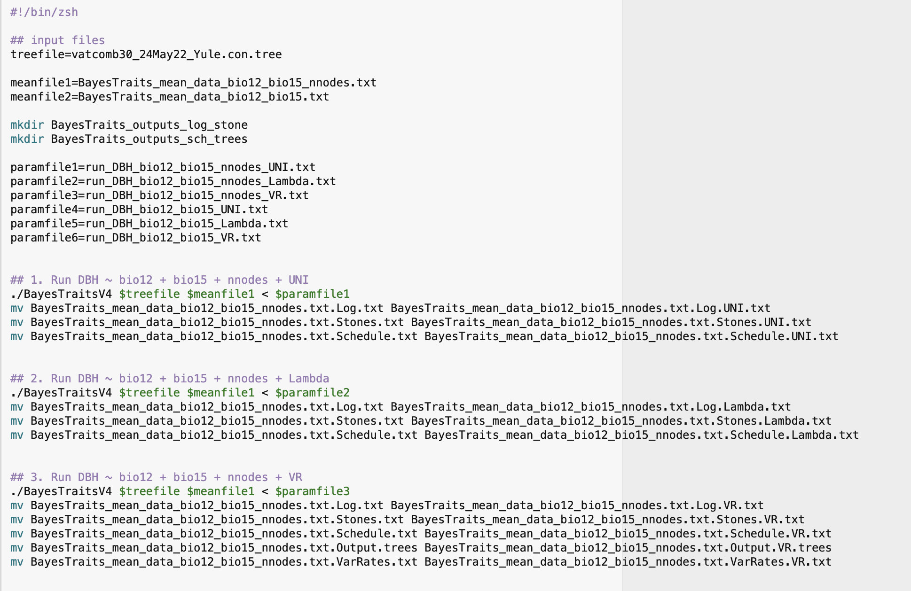
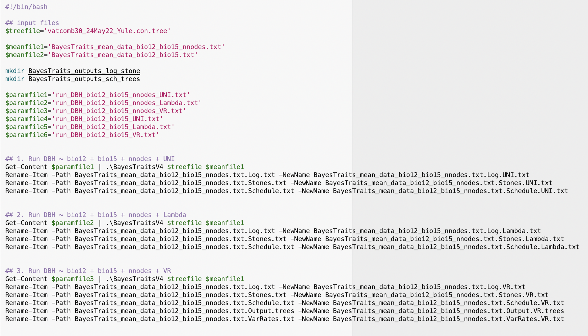
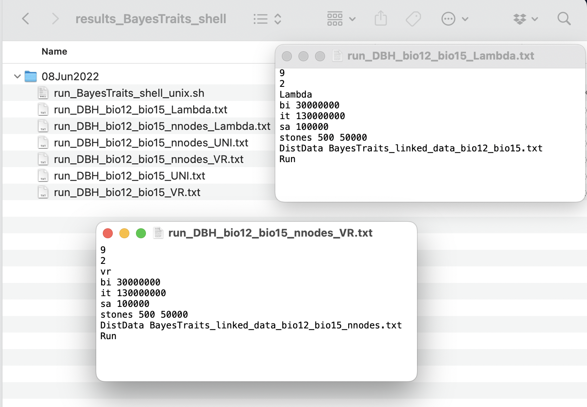
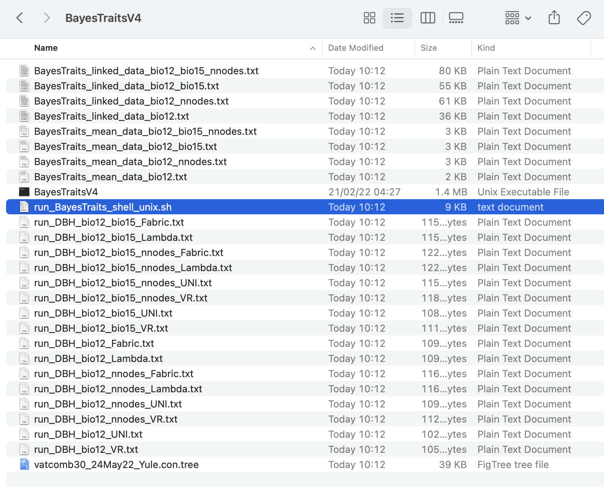

# 2. Shell scripts for independent contrast regression analysis

  
The main goal of the **InNOutBT** package is to readily create input
data and process output data for Meade & Pagel’s (2022)
[BayesTraits](https://www.evolution.reading.ac.uk/BayesTraitsV5.0.3/BayesTraitsV5.0.3.html)
program.  

Here in this article, we show how to use **InNOutBT**’s function
`phyreg.shell` for producing shell scripts and associated run commands
of BayesTraits phylogenetic independent contrast regression analyses.
Basically, the function `phyreg.shell` uses the directory paths to the
tree, mean, and linked data files as created with `phyreg.inputs` (see
article
[here](https://dboslab.github.io/InNOutBT/articles/phyreg_inputs.html)),
to automatically produce shell scripts in both Unix and Windows
PowerShell formats. The resulting single shell script file can then be
used for running one or multiple BayesTraits phylogenetic regressions
all at once, without manually setting new analyses with new parameters.
The shell script produced with `phyreg.shell` should thus have all
parameters for all analyses with any defined model. In addition to
saving the shell script directly in the BayesTraits directory, the
function saves all the separate running files with the specified
BayesTraits parameters (bi, it, sa, and st) for any run, depending on
the chosen model of tree transformation. See the [BayesTraits 5.0.3
Manual](https://www.evolution.reading.ac.uk/BayesTraitsV5.0.3/Files/BayesTraitsV5.0.2-Manual.pdf)
for further details on each of the BayesTraits parameters available for
phylogenetic regression so as to better understand how to set the
arguments of `phyreg.shell`.  
  

## Setup

**InNOutBT** is not on CRAN yet, but you can install the latest
development version from [GitHub](https://github.com/):

``` r

#install.packages("devtools")
devtools::install_github("DBOSlab/InNOutBT")
```

``` r

library(InNOutBT)
```

  

## Creating a Unix shell script

Set the argument `syst = "unix"` to create a shell script for running
the phylogenetic regressions on macOS Monterey.  

Note that you should give the path to the folder that contains the
BayesTraits executable file in the argument `BayesTraits_dir`, the name
of that file in `BayesTraits_exe`, and the name of the response variable
of your analysis in the argument `responvar`. Also, you should use the
argument `treetransf` to define any or all (listed as a vector)
available tree transformation models with which you want to run the
phylogenetic regressions on your input data. As such, choose among the
models *Kappa*, *Delta*, *Lambda*, *OU* (Ornstein–Uhlenbeck), *UNI* (if
you have set a complete default BayesTraits regression analysis, i.e.,
assuming uniform rates of evolution with no other tree transformation
models estimated), *VR* (if you have used variable rates), or *Fabric*
(if you want to use the general statistical model that accommodates an
uneven evolutionary landscape as described by [Pagel et
al. 2022](https://doi.org/10.1038/s41467-022-28595-z)).  

``` r

library(InNOutBT)

phyreg.shell(meanfile_dir = "results_BayesTraits_phyreg_input/09Jun2022",
             linkfile_dir = "results_BayesTraits_phyreg_input/09Jun2022",
             treefile_dir = "Data",
             BayesTraits_dir = "/Users/domingoscardoso/BayesTraits",
             BayesTraits_exe = "BayesTraitsV5",
             responvar = "DBH",
             treetransf = c("UNI", "Lambda", "VR", "Fabric"),
             Kappa = NULL,
             Delta = NULL,
             Lambda = NULL,
             OU = NULL,
             VRLambda = FALSE,
             bi = "30000000",
             it = "130000000",
             sa = "100000",
             st = c("500", "50000"),
             syst = "unix",
             dir_create = "results_BayesTraits_phyreg_shell",
             cc_DataTree = TRUE)
```

  
  

## Creating a Windows PowerShell script

Set the argument `syst = "windows"` to create a PowerShell script for
running the phylogenetic regressions on Windows.

``` r

phyreg.shell(meanfile_dir = "results_BayesTraits_phyreg_input/09Jun2022",
             linkfile_dir = "results_BayesTraits_phyreg_input/09Jun2022",
             treefile_dir = "Data",
             BayesTraits_dir = "C:/Users/Matt_/Documents/BayesTraits",
             BayesTraits_exe = "BayesTraitsV5",
             responvar = "DBH",
             treetransf = c("UNI", "Lambda", "VR", "Fabric"),
             Kappa = NULL,
             Delta = NULL,
             Lambda = NULL,
             OU = NULL,
             VRLambda = FALSE,
             bi = "30000000",
             it = "130000000",
             sa = "100000",
             st = c("500", "50000"),
             syst = "windows",
             dir_create = "results_BayesTraits_phyreg_shell",
             cc_DataTree = TRUE)
```



  
  
The function generates all running BayesTraits commands for the multiple
regressions, depending on the parameters set in the arguments
`treetransf`, `bi`, `it`, `sa`, and `st`.  
  


  
  
Note that because we have set the argument `cc_DataTree = TRUE`, the
tree, mean data, and linked data files were also copied directly into
the BayesTraits folder.  
  


  
  
Note that if you leave any of the arguments `Kappa`, `Delta`, `Lambda`,
and `OU` as the default *NULL*, these tree transformation models will be
estimated, provided that any of them were also listed in the argument
`treetransf`. But you can also set them as a vector with any specific
value between 0 and 1. For example, if you want to run analyses with
both specific and estimated values for `Lambda`, then you have to set a
vector such as *c(“0.001”, “1.0”, “Estimate”)*.  
  
Also, if you define the logical argument `VRLambda` as *TRUE*, then the
specific values set for the tree transformation models in the arguments
`Kappa`, `Delta`, `Lambda` or `OU` will be considered as separate runs
when using the model of variable rates *VR*, provided that you have also
chosen this model in the argument `treetransf`.  
  

## Running the Unix shell script

After using the function `phyreg.shell` with all the needed parameters,
you have to give the shell script permission to run automatically all
the phylogenetic regression analyses with the BayesTraits program. You
can just follow the steps below.  

**1.** Open the Terminal;  

**2.** Go to the BayesTraits program folder where you have saved the
shell script file **.sh** and the associated running and input data
files with the function `phyreg.shell`. The shell script should be named
**run_BayesTraits_phyreg_shell_unix.sh**;  

**3.** Execute the following line:  
**chmod 777 run_BayesTraits_phyreg_shell_unix.sh**

**4.** Then perform the BayesTraits run using the shell script by
executing the following line:  
**./run_BayesTraits_phyreg_shell_unix.sh**  
  

## Running the Windows PowerShell script

After using the function `phyreg.shell` with all the needed parameters,
you have to give the PowerShell script permission to run automatically
all the phylogenetic regression analyses with the BayesTraits program.
You can just follow the steps below, but you may also want to find
[further information on how to use Windows
PowerShell](https://docs.microsoft.com/en-us/powershell/module/microsoft.powershell.security/set-executionpolicy?view=powershell-7.2).

**1.** Open PowerShell as Administrator;  

**2.** Go to the BayesTraits program folder where you have saved the
PowerShell script file **.ps1** and the associated running and input
data files with the function `phyreg.shell`. The PowerShell script
should be named **run_BayesTraits_phyreg_shell_windows.ps1**;  

**3.** Execute the following line and choose option **\[Y\]Yes**;  
**Set-ExecutionPolicy -ExecutionPolicy RemoteSigned -Scope
LocalMachine**

**4.** Execute the following line:  
**Unblock-File -Path .\run_BayesTraits_phyreg_shell_windows.ps1**

**5.** Then perform the BayesTraits run using the PowerShell script by
executing the following line:  
**.\run_BayesTraits_phyreg_shell_windows.ps1**

  
  
See also an associated article on how to automatically [create input
files](https://dboslab.github.io/InNOutBT/articles/phyreg_inputs.html)
with `phyreg.inputs` for the phylogenetic regression analyses, as well
as another article on how to use `phyreg.outputs` to [process the
resulting output
files](https://dboslab.github.io/InNOutBT/articles/phyreg_outputs.html)
from the analyses.
