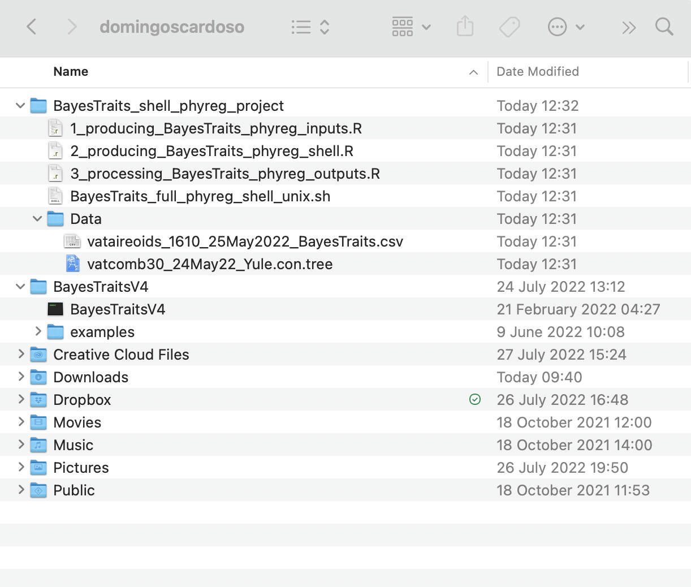
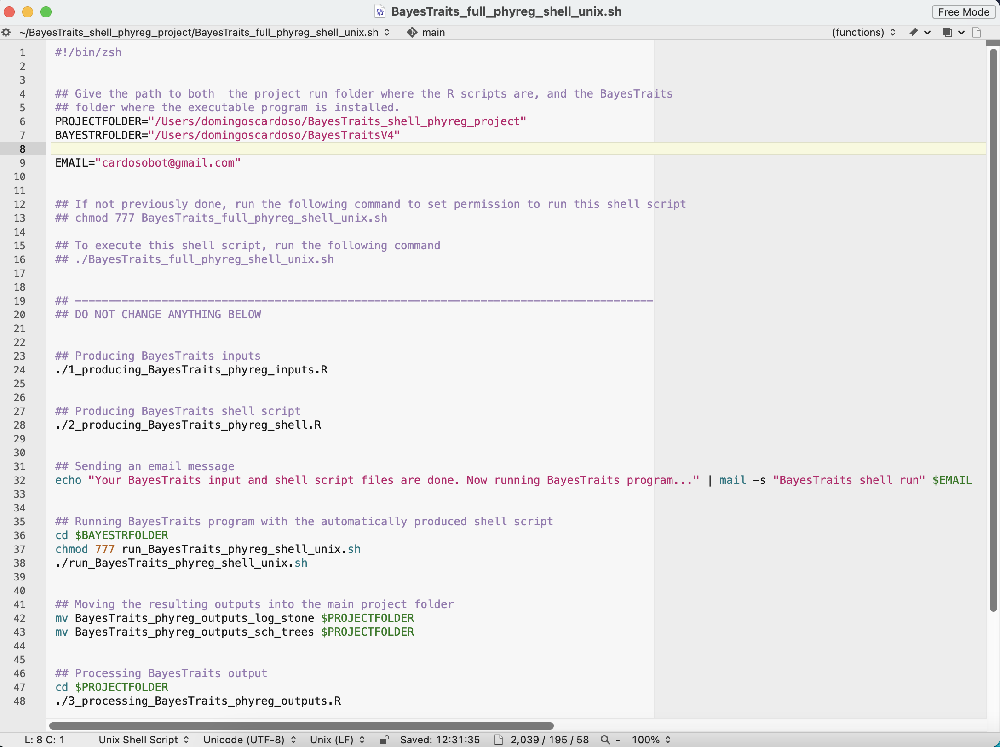
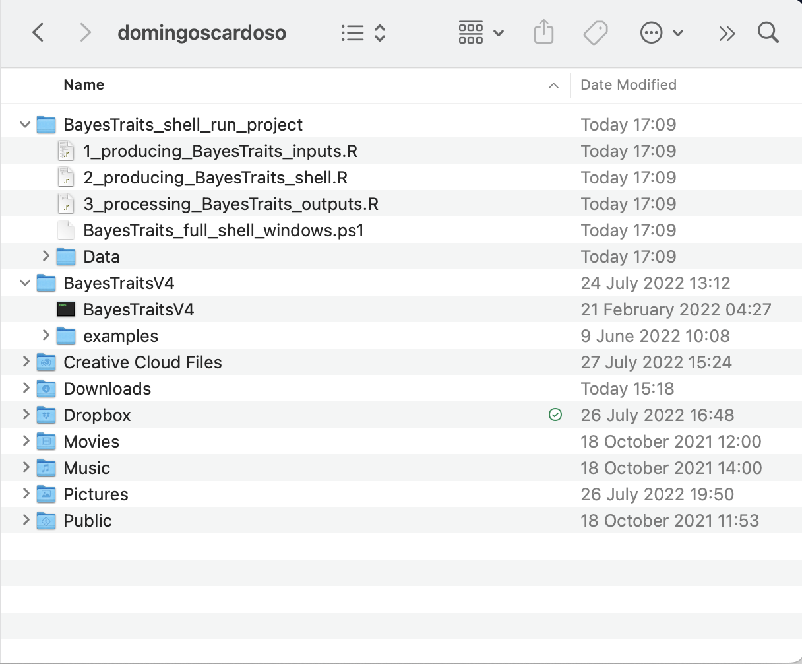
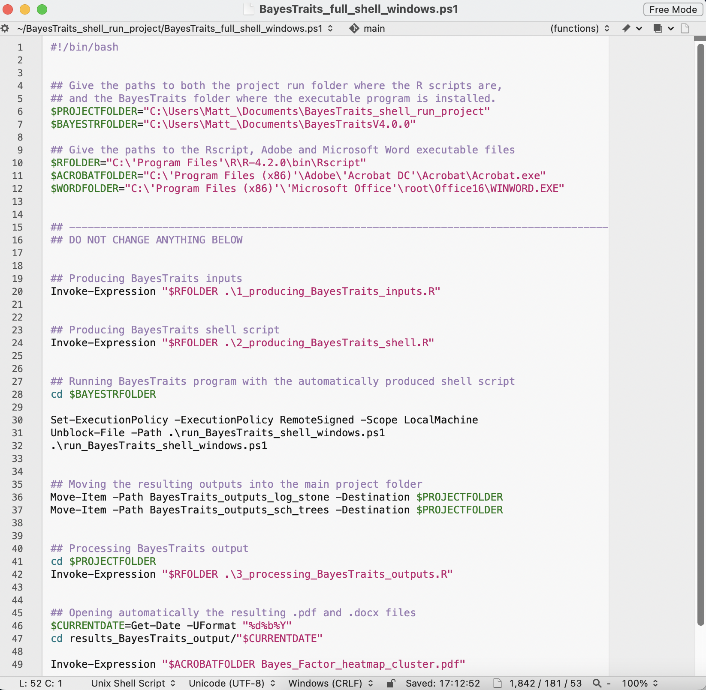

# Fully automated regression analysis and log processing with a shell script

  
The main goal of the **InNOutBT** package is to readily create input
data and process output data for Meade & Pagel’s (2022)
[BayesTraits](https://www.evolution.reading.ac.uk/BayesTraitsV5.0.3/BayesTraitsV5.0.3.html)
program.  

Here in this article, we show how to use **InNOutBT**’s function
`shell.phyreg.proj` for a full shell script run and log processing of
multiple phylogenetic regression analyses with Meade & Pagel’s (2022)
[BayesTraits](https://www.evolution.reading.ac.uk/BayesTraitsV5.0.3/BayesTraitsV5.0.3.html)
program. By reporting a directory path and the computer’s operating
system (“unix” or “windows”), this function creates the project folder
**BayesTraits_shell_phyreg_project** with associated example scripts.  

The available example of a shell script in Unix or Windows PowerShell
helps to fully automate both the complete BayesTraits regression
analyses and the processing of the resulting log and stones files, by
automatically running the three main **InNOutBT** functions
`phyreg.inputs`, `phyreg.shell`, and `phyreg.outputs`, without directly
opening the R or RStudio programs.  

Note that the **BayesTraits_shell_phyreg_project** folder that comes
with **InNOutBT** package was originally used in our recently published
specific study on the ecological diversification of the Vataireoid
legumes. So, you will have to edit the folder paths and analysis
parameters in these example scripts according to your desired regression
analyses. See the associated articles on how to set the parameters to
[create input
files](https://dboslab.github.io/InNOutBT/articles/phyreg_inputs.html)
with `phyreg.inputs` for the phylogenetic regression analyses, as well
as to [create the internal shell
script](https://dboslab.github.io/InNOutBT/articles/phyreg_shell.html)
with `phyreg.shell` for the actual BayesTraits runs, and to [process the
resulting output
files](https://dboslab.github.io/InNOutBT/articles/phyreg_outputs.html)
with `phyreg.outputs`. You might also want to see the [BayesTraits 5.0.3
Manual](https://www.evolution.reading.ac.uk/BayesTraitsV5.0.3/Files/BayesTraitsV5.0.2-Manual.pdf)
for further details on each of BayesTraits parameters available for
phylogenetic regressions so as to better understand how to set the
arguments available in the **InNOutBT** functions.  
  

## Setup

**InNOutBT** is not on CRAN yet, but you can install the latest
development version from [GitHub](https://github.com/):

``` r

#install.packages("devtools")
devtools::install_github("DBOSlab/InNOutBT")
```

``` r

library(InNOutBT)
```

  

## Creating a Unix shell project folder

The `shell.phyreg.proj` function is very simple and has only two
arguments. By just setting any path on your computer and the argument
`syst = "unix"`, you can readily create the project folder
**BayesTraits_shell_phyreg_project** with associated example files (R
scripts, shell script, and data folder) for running the phylogenetic
regressions of the Vataireoid legumes on macOS Monterey. But then you
can easily modify such available scripts for your specific analyses.  

``` r

library(InNOutBT)

shell.phyreg.proj(dir_create_proj = "/Users/domingoscardoso",
                  syst = "unix")
```

After running the `shell.phyreg.proj` function, it will readily create
the project folder **BayesTraits_shell_phyreg_project**, a data folder
with the input data files **vataireoids_1610_25May2022_BayesTraits.csv**
and **vatcomb30_24May22_Yule.con.tree**, as well as the main shell
script **BayesTraits_full_phyreg_shell_unix.sh** and R scripts
**1_producing_BayesTraits_phyreg_inputs.R**,
**2_producing_BayesTraits_phyreg_shell.R**, and
**3_processing_BayesTraits_phyreg_outputs.R**.  
  
  
  
You should see the associated articles on how to set the parameters to
[create input
files](https://dboslab.github.io/InNOutBT/articles/phyreg_inputs.html)
with `phyreg.inputs` for the phylogenetic regression analyses, as well
as to [create the internal shell
script](https://dboslab.github.io/InNOutBT/articles/phyreg_shell.html)
with `phyreg.shell` for the actual BayesTraits runs, and to [process the
resulting output
files](https://dboslab.github.io/InNOutBT/articles/phyreg_outputs.html)
with `phyreg.outputs`. In these articles, you will find how to fully
edit the R scripts **1_producing_BayesTraits_phyreg_inputs.R**,
**2_producing_BayesTraits_phyreg_shell.R**, and
**3_processing_BayesTraits_phyreg_outputs.R** according to your
particular study. Otherwise, if you run the example files with the same
parameter settings, you will be able to fully reproduce the analysis of
our Vataireoid legume study.  

The main shell script file **BayesTraits_full_phyreg_shell_unix.sh**
performs the full phylogenetic regression analysis and processing of
results. Its first lines hold the paths to your folders, as shown in the
image below, which you will set in the next section. The path in the
image is an example from an earlier version of BayesTraits, so yours
will be different.  
  
  
  

## Running the Unix shell script

You will work with two folders: the project folder
**BayesTraits_shell_phyreg_project** and the folder where the
BayesTraits executable file is installed. You always start the analysis
from the **project folder**. You do not need to open the BayesTraits
folder, because the main shell script moves there by itself to run the
analyses, and then brings the results back to the project folder.  

### Before the first run

**1.** Download and install
[BayesTraits](https://www.evolution.reading.ac.uk/BayesTraitsV5.0.3/BayesTraitsV5.0.3.html)
in any folder. Note the path to that folder and the name of the
executable file, such as **BayesTraitsV5**.  

**2.** Check that the executable file starts, by running its full path
in the Terminal. If it starts and keeps waiting, press Control + C to
leave it.

``` bash
/Users/yourname/BayesTraits/BayesTraitsV5
```

If macOS stops the program, for instance with the message **killed** or
a warning that it cannot be opened, this is because macOS blocks
programs downloaded from the internet that are not signed. If you trust
the source of the download, remove the block with the following line,
and then check again:

``` bash
xattr -d com.apple.quarantine /Users/yourname/BayesTraits/BayesTraitsV5
```

**3.** Check that **InNOutBT** and **treeio** are installed in R. The
package **treeio** is used to read the tree in the first R script and is
available from
[Bioconductor](https://bioconductor.org/packages/treeio/):

``` r

#install.packages("BiocManager")
BiocManager::install("treeio")
```

**4.** Check in the Terminal that **pandoc** is available, because it is
needed to write the Word table. If the following line returns `FALSE`,
[install pandoc](https://pandoc.org/installing.html):

``` bash
Rscript -e 'rmarkdown::pandoc_available()'
```

### Editing the project files

Open each of the following files in any text editor, such as RStudio.  

**5.** In the main shell script
**BayesTraits_full_phyreg_shell_unix.sh**, set:  

- **PROJECTFOLDER**: the path to the project folder;
- **BAYESTRFOLDER**: the path to the **folder** that contains the
  BayesTraits executable file, not the path to the file itself;
- **EMAIL**: your e-mail address, to receive a message when the analyses
  start and finish. This depends on your computer being set up to send
  e-mail with the `mail` command, but the analyses will run even if the
  message is not sent.

``` bash
PROJECTFOLDER="/Users/yourname/BayesTraits_shell_phyreg_project"
BAYESTRFOLDER="/Users/yourname/BayesTraits"
EMAIL="your.address@example.com"
```

**6.** In the R script **2_producing_BayesTraits_phyreg_shell.R**, set
the same BayesTraits folder again, as well as the name of the executable
file. Both paths to the BayesTraits folder must be identical:

``` r
BayesTraits_dir = "/Users/yourname/BayesTraits",
BayesTraits_exe = "BayesTraitsV5",
```

**7.** For your own study, also edit the three numbered R scripts as
described in the articles mentioned above, and replace the files in the
**Data** folder. To check that everything works before a long analysis,
you can first set a few iterations in
**2_producing_BayesTraits_phyreg_shell.R**, such as `bi = "2000"`,
`it = "12000"`, `sa = "500"`, and `st = c("10", "200")`. These values
are only for testing, so set your final values again before the real
analysis.  

### Running the analysis

**8.** Open the Terminal and move to the project folder:

``` bash
cd /Users/yourname/BayesTraits_shell_phyreg_project
```

**9.** Allow the main shell script to run. You need to do this only
once:

``` bash
chmod 777 BayesTraits_full_phyreg_shell_unix.sh
```

**10.** Start the full analysis:

``` bash
./BayesTraits_full_phyreg_shell_unix.sh
```

Keep the Terminal open and the computer awake until the script finishes.
With the number of iterations in the example scripts, this can take a
long time.  

### What the script does

The main shell script then performs the following steps, with no further
action from you:  

**1.** Runs **1_producing_BayesTraits_phyreg_inputs.R**, which saves the
input files in the folder **results_BayesTraits_phyreg_input**;  

**2.** Runs **2_producing_BayesTraits_phyreg_shell.R**, which saves the
run commands in the folder **results_BayesTraits_phyreg_shell** and
copies them to the BayesTraits folder, with the data and tree files;  

**3.** Moves to the BayesTraits folder and runs all the analyses,
removing the copied files at the end;  

**4.** Moves the results to the folders
**BayesTraits_phyreg_outputs_log_stone** and
**BayesTraits_phyreg_outputs_sch_trees** in the project folder;  

**5.** Runs **3_processing_BayesTraits_phyreg_outputs.R**, which saves
the final table and the heatmaps in the folder
**results_BayesTraits_phyreg_output**, within a subfolder named with the
current date, and opens these files.  

### If something goes wrong

The script continues after an error, so one problem can produce many
messages. Look at the **first** error in the Terminal, because the later
ones are often just consequences.  

| Message | Likely cause and solution |
|:---|:---|
| `chmod: BayesTraits_full_phyreg_shell_unix.sh: No such file or directory` | You are not in the project folder. Repeat step 8. |
| `cannot open file '.../run_BayesTraits_phyreg_shell_unix.sh'` | `BayesTraits_dir` is wrong in **2_producing_BayesTraits_phyreg_shell.R**. See step 6. |
| `cd: no such file or directory` | `BAYESTRFOLDER` is wrong in the main shell script. See step 5. |
| `killed`, or many `mv: rename ...Log.txt ...: No such file or directory` messages | BayesTraits did not run. macOS may have blocked it (step 2), or `BayesTraits_exe` is wrong (step 6). |
| `Error in combinat::combn(fnames, 2) : n < m` | There are no results to process, because BayesTraits did not run. Solve the first error shown. |

  
  

## Creating a Windows PowerShell project folder

In the `shell.phyreg.proj` function, you can set any path on your PC and
the argument `syst = "windows"` to readily create the project folder
**BayesTraits_shell_phyreg_project** with associated example files (R
scripts, PowerShell script, and data folder) for running the
phylogenetic regressions of the Vataireoid legumes on a Windows PC. But
then you can easily modify such available scripts for your specific
analyses.  

``` r

library(InNOutBT)

shell.phyreg.proj(dir_create_proj = "C:/Users/Matt_/Documents",
                  syst = "windows")
```

After running the `shell.phyreg.proj` function, it will readily create
the project folder **BayesTraits_shell_phyreg_project**, a data folder
with the input data files **vataireoids_1610_25May2022_BayesTraits.csv**
and **vatcomb30_24May22_Yule.con.tree**, as well as the main PowerShell
script **BayesTraits_full_phyreg_shell_windows.ps1** and R scripts
**1_producing_BayesTraits_phyreg_inputs.R**,
**2_producing_BayesTraits_phyreg_shell.R**, and
**3_processing_BayesTraits_phyreg_outputs.R**.  
  
  
  
You should see the associated articles on how to set the parameters to
[create input
files](https://dboslab.github.io/InNOutBT/articles/phyreg_inputs.html)
with `phyreg.inputs` for the phylogenetic regression analyses, as well
as to [create the internal shell
script](https://dboslab.github.io/InNOutBT/articles/phyreg_shell.html)
with `phyreg.shell` for the actual BayesTraits runs, and to [process the
resulting output
files](https://dboslab.github.io/InNOutBT/articles/phyreg_outputs.html)
with `phyreg.outputs`. In these articles, you will find how to fully
edit the R scripts **1_producing_BayesTraits_phyreg_inputs.R**,
**2_producing_BayesTraits_phyreg_shell.R**, and
**3_processing_BayesTraits_phyreg_outputs.R** according to your
particular study. Otherwise, if you run the example files with the same
parameter settings, you will be able to fully reproduce the analysis of
our Vataireoid legume study.  

The main PowerShell script file
**BayesTraits_full_phyreg_shell_windows.ps1** performs the full
phylogenetic regression analyses and processing of results. Its first
lines hold the paths to your folders and programs, as shown in the image
below, which you will set in the next section. The paths in the image
are examples from an earlier version of BayesTraits and R, so yours will
be different.  
  
  
  

## Running the Windows PowerShell script

As in Unix, you always start the analysis from the **project folder**,
and the main PowerShell script moves to the BayesTraits folder by
itself. You may also want to find [further information on how to use
Windows
PowerShell](https://docs.microsoft.com/en-us/powershell/module/microsoft.powershell.security/set-executionpolicy?view=powershell-7.2).  

### Editing the project files

**1.** In the main PowerShell script
**BayesTraits_full_phyreg_shell_windows.ps1**, set **\$PROJECTFOLDER**
to the path of the project folder, and **\$BAYESTRFOLDER** to the path
of the **folder** that contains the BayesTraits executable file. Also
set the paths to the Rscript, Adobe Acrobat, and Microsoft Word
executable files in **\$RFOLDER**, **\$ACROBATFOLDER**, and
**\$WORDFOLDER**;  

**2.** In the R script **2_producing_BayesTraits_phyreg_shell.R**, set
`BayesTraits_dir` to the same path as **\$BAYESTRFOLDER**, and
`BayesTraits_exe` to the name of the executable file, such as
`"BayesTraitsV5"`;  

### Running the analysis

**3.** Open PowerShell as Administrator;  

**4.** Move to the project folder **BayesTraits_shell_phyreg_project**,
i.e. the same where you should have the main PowerShell script
**BayesTraits_full_phyreg_shell_windows.ps1**;  

**5.** Execute the following line and choose option **\[Y\]Yes**;  
**Set-ExecutionPolicy -ExecutionPolicy RemoteSigned -Scope
LocalMachine**

**6.** Execute the following line:  
**Unblock-File -Path .\BayesTraits_full_phyreg_shell_windows.ps1**

**7.** Then perform the full R and BayesTraits run using the PowerShell
script by executing the following line:  
**.\BayesTraits_full_phyreg_shell_windows.ps1**
